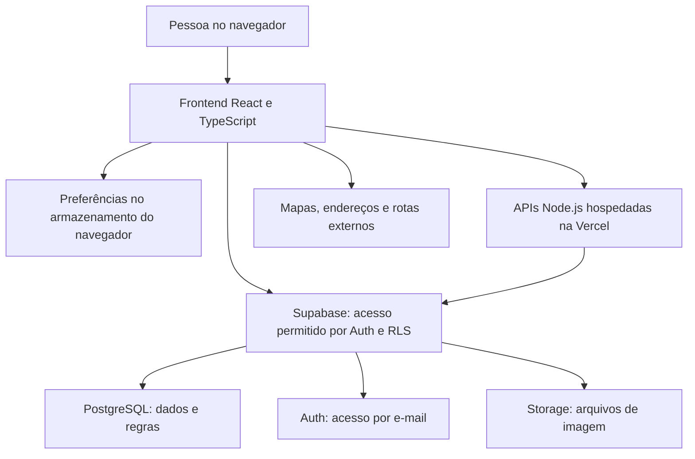

# Apoio na Rede — guia de estudo e apresentação da proposta

**Data:** 12 de outubro de 2026.  
**Base:** resumo fornecido e código disponível no projeto nesta data.  
**Objetivo:** explicar a proposta, demonstrar o funcionamento e responder a perguntas de público, avaliadores, parceiros e equipe técnica.

Este documento descreve a implementação no repositório. A versão publicada pode estar diferente até a conclusão do deploy. Recursos desativados ou ainda sem uma interface completa estão identificados abaixo.

## 1. A proposta em uma frase

O Apoio na Rede ajuda pessoas a planejar visitas a locais e serviços de Cataguases conforme suas necessidades de acessibilidade, mostrando o que está informado, o que não atende aos requisitos e o que ainda precisa ser confirmado.

**Mensagem principal para memorizar:** a pessoa escolhe o que precisa; a plataforma compara essas necessidades com as informações disponíveis e explica o resultado.

### Apresentação de aproximadamente um minuto

> Antes de sair de casa, uma pessoa pode precisar saber se conseguirá entrar em uma clínica, circular em um restaurante ou receber atendimento adequado. Essas informações costumam estar espalhadas ou incompletas.
>
> O Apoio na Rede reúne locais e serviços de Cataguases e permite selecionar necessidades concretas, como entrada sem degraus, banheiro adaptado ou atendimento em Libras. Cada necessidade pode ser indispensável ou desejável.
>
> A plataforma compara essas escolhas com os recursos informados e mostra o que atende, o que não atende e o que ainda não foi verificado. Também oferece endereço, contatos, avaliações e opções de deslocamento.
>
> A comunidade e os responsáveis pelos locais podem contribuir, com revisão administrativa dos cadastros antes da publicação. A proposta é apoiar decisões e ampliar a autonomia. A comparação não substitui uma vistoria técnica nem garante que o percurso esteja livre de obstáculos.

## 2. Principais perguntas sobre a proposta

### Qual problema o projeto resolve?

A dificuldade de encontrar, antes de uma visita, informações úteis sobre as condições de acesso, circulação e atendimento de um local. A ausência dessas informações pode gerar deslocamentos frustrados, dependência de terceiros e dificuldade para escolher um serviço.

O projeto organiza essas informações e reduz a incerteza. Seu alcance depende da cobertura e da atualização do catálogo.

### Para quem ele foi pensado?

Para pessoas com deficiência e outras pessoas que precisam de recursos específicos de acesso ou atendimento. Acompanhantes, familiares, cuidadores e pessoas com limitações temporárias também podem usar a ferramenta.

Estabelecimentos, profissionais e serviços públicos são participantes importantes: podem fornecer informações, receber relatos e identificar necessidades de atualização.

### Por que começar por Cataguases?

Uma cidade inicial delimita o levantamento de dados, a moderação e a validação com usuários. É mais viável acompanhar a qualidade de uma base local do que prometer cobertura ampla desde o início.

**Resposta para apresentação:** “Começamos por Cataguases para validar a utilidade e a qualidade das informações em um território definido. A expansão dependerá dos resultados e da capacidade de manter os dados.”

### Qual é o diferencial em relação a uma busca comum de mapas?

A comparação por necessidade concreta, acompanhada da explicação do resultado. Encontrar um endereço não responde, por si só, se ele possui os recursos indispensáveis para determinada pessoa.

Por exemplo, um restaurante pode atender às necessidades de uma pessoa que busca atendimento em Libras e ainda não ter informações suficientes para outra que precisa de banheiro adaptado.

### A plataforma é um aplicativo de celular?

Hoje, é uma aplicação web com interface adaptada a telas de computador e celular. O acesso ocorre pelo navegador. Não é necessário apresentar o projeto como um aplicativo nativo instalado por uma loja.

### Preciso informar um diagnóstico?

Não. O perfil de requisitos permite selecionar recursos necessários sem informar um diagnóstico. Essas escolhas são guardadas no navegador, sem sincronização de perfil entre dispositivos na implementação atual.

O formulário de avaliação possui uma categoria de acessibilidade avaliada. Ela contextualiza o comentário, mas não deve ser apresentada como uma exigência de diagnóstico clínico.

### Todos os locais listados são acessíveis?

Não. Um local pode ter recursos confirmados, recursos informados como ausentes e recursos desconhecidos. Além disso, pessoas diferentes podem precisar de recursos diferentes.

**Resposta curta:** “Estar no catálogo significa que há informações sobre o local. A compatibilidade precisa ser consultada conforme as necessidades de cada pessoa.”

### Um cadastro aprovado certifica o estabelecimento?

Não. A aprovação é uma decisão de publicação ou revisão da informação. Ela não equivale a uma inspeção presencial de todos os recursos, laudo técnico ou certificação.

É possível aprovar endereço e contato de um local e continuar sem confirmação sobre seu banheiro ou sua entrada. O status geral do cadastro e o estado de cada recurso são informações diferentes.

### Quem fornece as informações?

O catálogo combina cadastros públicos, informações pesquisadas em fontes identificadas, descoberta por serviços de mapas e relatos da comunidade. Uma fonte pode comprovar o endereço sem comprovar a acessibilidade.

Quando disponíveis, fonte e data de consulta ajudam a contextualizar a informação. Não se deve prometer que todos os registros já possuem documentação detalhada de cada recurso.

### O que acontece quando a informação está errada ou desatualizada?

Administradores autorizados podem editar os locais existentes. Há também mecanismos de denúncia de avaliações e revisão de contribuições na estrutura do projeto.

Como operação do piloto, recomenda-se definir um canal de correção, responsáveis e uma rotina de atualização. A existência de ferramentas de moderação não significa que já exista uma equipe permanente ou um prazo garantido de resposta.

### Quem pode cadastrar e quem pode editar?

O cadastro público de locais e profissionais pode ser enviado sem login do colaborador. No modo online, ele fica pendente e depende da revisão do titular autorizado para publicação.

O **Painel administrador**, em `/admin`, exige e-mail, senha e autorização administrativa. Ele lista cadastros de locais, profissionais e trechos, permite aprovar ou recusar pendentes e editar dados e fotos de locais. `/gestao` continua compatível. A edição pública por qualquer visitante não está disponível.

### As avaliações são confiáveis?

São experiências relatadas por visitantes, úteis para contextualizar uma visita. Não substituem uma avaliação técnica de acessibilidade.

O sistema limita a repetição por identificador do navegador e oferece mecanismos de denúncia. Isso reduz alguns abusos, mas não comprova a identidade de quem publicou nem impede totalmente avaliações coordenadas ou falsas.

### A plataforma já demonstrou impacto social?

A implementação e os testes técnicos demonstram funcionamento de regras e fluxos. Eles não demonstram, por si só, aumento de autonomia, redução de deslocamentos frustrados ou satisfação dos usuários.

Esses resultados precisam ser medidos em um piloto com participantes reais. Na apresentação, trate o impacto como objetivo a validar, sem inventar números de usuários, instituições parceiras ou resultados.

## 3. O que existe hoje e o que precisa ser apresentado com cuidado

| Recurso | Situação no código | Como apresentar |
| --- | --- | --- |
| Busca e consulta de locais | Implementadas, com catálogo e integrações externas | Demonstrar com dados reais ou exemplos identificados |
| Perfil de requisitos | Implementado, com persistência no navegador | Mostrar as escolhas indispensável, desejável e não necessário |
| Comparação de compatibilidade | Implementada com regras em TypeScript | Mostrar atendidos, não atendidos e sem informação |
| Ocultar requisitos indispensáveis não atendidos | Implementado para ausência explicitamente informada | Não prometer exclusão automática de todos os desconhecidos |
| Cadastro público de locais | Implementado, com revisão no modo online | Explicar que envio não é publicação automática |
| Cadastro e busca de profissionais | Interface implementada | Informações cadastradas não garantem credenciamento ou disponibilidade atual |
| Fotos de locais | Cadastro e edição aceitam links e arquivos | Mostrar o envio, a escolha de capa e a persistência |
| Gestão de locais | Implementada no painel `/admin` | Demonstrar com uma conta administrativa autorizada |
| Avaliações sem conta | Implementadas | Explicar a limitação por navegador |
| Trajeto a pé até um destino | Integração implementada | Apresentar como orientação de deslocamento sem auditoria de acessibilidade |
| Seção de rotas e trechos | Temporariamente inativa na navegação atual | Explicar como parte da proposta e da estrutura existente, sem demonstrar como recurso ativo |
| Relatos de acessibilidade com fotos | Serviço de envio, armazenamento e consulta de aprovados existentes | A interface atual exibe relatos aprovados; não há formulário de envio conectado na página de detalhe inspecionada |
| Moderação de cadastros | Fila em `/admin`, com filtros, aprovação e recusa | O painel de cadastros não é uma fila de moderação de avaliações ou relatos |
| Controles de acessibilidade da interface | Implementados, alguns dependentes do navegador e de serviços externos | Demonstrar e registrar limitações observadas |

**Atenção:** o detalhamento do local não deve ser apresentado como uma galeria completa de fotos de ambientes. Os fluxos atuais de cadastro, capa, edição, revisão e evidências de relatos têm finalidades distintas.

## 4. Como explicar a compatibilidade

### O que o usuário escolhe?

Para cada recurso disponível no perfil, a pessoa informa se ele é **indispensável**, **desejável** ou **não necessário**. Recursos não necessários ficam fora da comparação.

### Como o sistema interpreta os dados do local?

| Estado do recurso | Significado | Efeito na comparação |
| --- | --- | --- |
| Sim | O recurso foi informado como presente | Conta como requisito atendido |
| Não | O recurso foi informado como ausente | Conta como requisito não atendido |
| Não verificado | A informação não está disponível ou permanece inconclusiva | Aparece como sem informação |

Não preencher um recurso não significa responder “Não”. Uma falha de consulta também não comprova a ausência de acessibilidade.

### Exemplo para usar na apresentação

Uma pessoa seleciona:

- Entrada sem degraus: indispensável.
- Banheiro adaptado: indispensável.
- Atendimento em Libras: desejável.

No local, a entrada está informada como presente, o banheiro não foi verificado e o atendimento em Libras está informado como ausente.

O resultado é **“Atende 1 de 3 requisitos”**, acompanhado de um requisito atendido, um não atendido e um sem informação. Isso não significa que o local seja “33% acessível”: a contagem representa apenas os requisitos escolhidos e os dados disponíveis.

### O filtro elimina locais sem confirmação de um recurso indispensável?

Na implementação atual, ele oculta locais com recurso indispensável **explicitamente não atendido**. Um recurso indispensável desconhecido continua sendo mostrado como pendência e, por si só, não ativa essa exclusão.

Essa distinção está em `hasUnmetEssential`, no arquivo `src/utils/needsCompatibility.ts`.

### A comparação usa inteligência artificial?

Não. É uma regra determinística: cruza o perfil com os estados dos recursos cadastrados. O resultado pode ser explicado e testado sem um modelo de IA.

Serviços externos, como tradução assistiva ou reconhecimento de voz, possuem suas próprias tecnologias. Isso não muda o fato de que a regra de compatibilidade do projeto é implementada em TypeScript.

### Como entram as confirmações da comunidade?

O código considera relatos aprovados por recurso. Pelo menos três respostas concordantes, sem resposta contrária entre os relatos considerados, podem gerar uma confirmação comunitária. Havendo respostas positivas e negativas, o recurso fica inconclusivo.

É uma regra de consolidação de relatos, não uma garantia de verdade nem uma auditoria profissional. Ela depende da moderação e da qualidade das contribuições.

## 5. Arquitetura: como as partes se conectam



**Como explicar em voz alta:** “A interface roda no navegador. Algumas consultas usam diretamente o Supabase, com permissões no banco. Os fluxos que precisam de validação adicional ou de chave secreta passam pelas funções da Vercel. Preferências pessoais ficam no navegador, e mapas e rotas vêm de serviços especializados.”

### Qual é a função de cada tecnologia?

| Tecnologia | Responsabilidade | Motivo prático no projeto |
| --- | --- | --- |
| React 19 | Composição da interface e atualização de telas | Organiza componentes e estados de busca, formulários e preferências |
| TypeScript | Tipagem do código | Ajuda a manter contratos entre dados, serviços e componentes |
| Vite 8 | Desenvolvimento e geração do frontend | Prepara os arquivos publicados e oferece o servidor de desenvolvimento |
| Tailwind CSS | Estilos utilitários | Permite compor layouts e estados visuais nos componentes |
| Componentes próprios e Lucide | Interface reutilizável e ícones | Padronizam a apresentação; ícones precisam de texto ou nome acessível quando necessário |
| Node.js em funções serverless | Execução das APIs | Valida requisições e executa operações de servidor |
| Vercel | Hospedagem do frontend e das funções | Publica o projeto e disponibiliza endpoints HTTP |
| Supabase | Banco, autenticação e arquivos | Reúne os serviços de dados usados pela aplicação |
| PostgreSQL | Persistência relacional e integridade | Armazena registros e aplica restrições e regras |
| RLS | Controle de acesso por registro | Define quais linhas cada identidade pode consultar ou alterar |

### Por que TypeScript não substitui a validação da API?

Os tipos ajudam durante o desenvolvimento, mas não impedem que alguém envie uma requisição manual com valores inválidos. O servidor precisa conferir os dados recebidos em tempo de execução.

### O que significa serverless?

O código da API executa na infraestrutura gerenciada da plataforma de hospedagem. A equipe não precisa manter um servidor Node permanentemente ligado por conta própria.

Ainda existem limites de execução, consumo, disponibilidade e custos. “Serverless” não significa ausência de infraestrutura ou operação.

### Por que usar um banco relacional?

Locais possuem critérios, avaliações e contribuições associados. PostgreSQL permite relacionar esses registros, aplicar restrições e controlar a integridade das operações.

O Supabase também fornece autenticação e arquivos, mas essas responsabilidades permanecem distintas: dados estruturados ficam no banco, imagens ficam no Storage e as identidades são gerenciadas pelo Auth.

### O frontend conversa diretamente com o banco?

Ele pode acessar a API de dados do Supabase por meio do cliente público, conforme as permissões concedidas. Não recebe credenciais de administrador do PostgreSQL.

Isso exige políticas e permissões corretas no backend. Esconder um botão não protege dados; a autorização precisa ser aplicada no servidor ou no banco.

## 6. Cadastros, aprovação, edição e imagens

### Como um novo local é publicado?

1. O visitante preenche os dados e os recursos que consegue informar.
2. O frontend envia o cadastro para `/api/register-place`.
3. A API valida os campos, limita o conteúdo aceito e envia a operação ao Supabase.
4. O registro online é criado como pendente.
5. O registro aparece na fila de cadastros do painel administrador.
6. Um administrador autorizado entra em `/admin` com e-mail e senha e aprova ou recusa, informando o motivo quando necessário.

O fluxo atual não envia links de aprovação por e-mail e não depende de SMTP para login ou revisão. O responsável consulta os novos registros no painel e pode atualizar a lista.

### Como adiciono uma foto que ficou faltando?

1. Acesse **Gerenciar locais** pelo rodapé ou pelo cadastro.
2. Entre com o e-mail administrativo autorizado e sua senha.
3. Busque o local e clique em **Editar**.
4. Adicione uma imagem por link ou selecione um arquivo do computador ou celular.
5. Escolha a capa, se desejar, e clique em **Salvar alterações**.

O sistema altera o registro existente. Ele preserva o status do cadastro e suas avaliações. Um local pendente não é aprovado automaticamente por receber uma foto.

### O que acontece se dois administradores editarem ao mesmo tempo?

O formulário usa a versão `atualizado_em` carregada ao abrir o cadastro. Se outra edição atualizar essa versão antes do salvamento, a operação é recusada com orientação para reabrir o registro.

Essa proteção evita sobrescrever outra edição realizada por esse fluxo. Não deve ser apresentada como um histórico completo ou sistema de auditoria de todas as alterações.

### Quais imagens podem ser enviadas?

Nos formulários de locais, são aceitos arquivos JPG, PNG e WebP de até 10 MB. O navegador reduz a imagem e a converte para JPEG antes de enviar. O limite é de dez fotos no total, contando links e arquivos.

As fotos de locais são armazenadas no bucket público `place-photos`. A primeira foto é usada como capa. Remover a referência do cadastro não apaga automaticamente o arquivo antigo do armazenamento.

### Fotos de locais e fotos de relatos têm a mesma proteção?

Não. São fluxos diferentes:

| Tipo | Armazenamento e acesso |
| --- | --- |
| Foto de local | URL pública no bucket `place-photos`, para exibição do cadastro |
| Foto de relato | Bucket `report-photos`, políticas de acesso e URLs assinadas temporárias |

Não prometa que toda imagem do projeto é privada. Uma URL assinada limita o acesso durante sua validade, mas não impede que uma pessoa autorizada salve a imagem.

## 7. Mapas, endereços e trajetos

### Qual é a função dos serviços de localização?

| Serviço | Uso no projeto |
| --- | --- |
| OpenStreetMap e serviços associados | Dados geográficos e descoberta complementar de lugares e endereços |
| Photon e Nominatim | Geocodificação: transformar uma descrição de endereço em coordenadas |
| ViaCEP | Consulta de informações de endereço a partir do CEP |
| Google Maps e Places | Mapa interativo, descoberta de locais e consulta de informações quando configurados |
| Serviço de rotas de pedestres | Geometria do percurso, distância e duração estimadas |

A presença de consultas ao OpenStreetMap não significa que já exista um mapa visual próprio completamente intercambiável com Google Maps. O componente de mapa atual utiliza a integração Google quando disponível.

### Endereço encontrado significa ponto exato confirmado?

Não. A geocodificação pode localizar uma rua, região ou ponto aproximado. Alguns registros pesquisados possuem indicação de coordenadas não confirmadas.

Antes de usar proximidade ou deslocamento, a aplicação precisa respeitar a qualidade desse ponto. A edição de endereço exige nova localização ou confirmação das coordenadas.

### A rota calculada é acessível para uma cadeira de rodas?

O projeto não pode garantir isso. Uma rota a pé é uma orientação de deslocamento; ela não comprova largura de calçada, inclinação, presença de degraus, travessias adequadas ou ausência de obstáculos temporários.

**Resposta para memorizar:** “Acessibilidade do destino e acessibilidade do caminho são avaliações diferentes. A primeira versão informa recursos dos locais e oferece orientação de deslocamento, sem certificar o percurso.”

### A localização do usuário é obrigatória?

A consulta ao catálogo e aos detalhes não exige, por si só, compartilhar a posição atual. Recursos que utilizam a origem do visitante dependem da permissão de geolocalização e das condições do dispositivo.

Ao usar serviços externos de localização e rota, endereços e coordenadas podem ser transmitidos aos respectivos provedores. Preferências guardadas localmente não tornam todas as integrações inteiramente locais.

### O sistema funciona sem internet?

Há um modo de demonstração que armazena dados no navegador e dispensa o banco compartilhado. Isso não equivale a uma solução completa para uso offline: mapas, buscas externas, trajetos e recursos de terceiros podem depender de conexão.

### O que acontece se um serviço externo falhar?

A aplicação possui tratamentos de erro e alternativas em alguns fluxos. Uma falha deve ser comunicada como indisponibilidade, sem inventar contatos, recursos ou trajetos.

Não existe garantia de que todo recurso possua uma alternativa equivalente. Cobertura, quotas, latência e disponibilidade dos provedores fazem parte das limitações operacionais.

## 8. Acessibilidade da própria interface

### Quais recursos a interface oferece?

Controles de contraste, tamanho de texto, fonte para dislexia, redução de estímulos, leitura em voz alta, busca por voz e navegação por teclado, além da integração VLibras.

Esses recursos ajudam a adaptar o uso, mas o atendimento a uma pessoa não deve depender somente de um botão de acessibilidade ou de um widget.

### Ter VLibras torna todo o site acessível?

Não. VLibras é um recurso complementar. A interface também precisa de estrutura semântica, textos compreensíveis, controles identificados, foco visível, contraste adequado e operação por teclado.

A tradução assistiva e os recursos de voz dependem de disponibilidade e compatibilidade. A apresentação não deve prometer interpretação perfeita de todo conteúdo.

### Como validar a acessibilidade de verdade?

Combinar testes automáticos, inspeção manual por teclado e tecnologias assistivas, e sessões com pessoas com diferentes necessidades. O sucesso em um navegador ou com um perfil de usuário não comprova atendimento a todos.

O projeto já possui verificações de interface, mas não deve ser apresentado como plenamente certificado em acessibilidade digital sem uma avaliação específica e documentada.

## 9. Segurança e privacidade: respostas para a banca

### O que é RLS, em termos simples?

É uma regra do banco que define quais registros uma identidade pode ler ou alterar. Por exemplo, visitantes públicos podem consultar locais publicados, enquanto administradores autorizados podem acessar registros para gestão.

RLS complementa as permissões de tabelas e funções. Ela depende de configuração correta e precisa ser testada, inclusive para tentativas de acesso indevido.

### Como o sistema sabe quem é administrador?

O usuário autentica pelo Supabase, e o sistema consulta a autorização administrativa mantida no backend. A gestão verifica o usuário e a função `is_site_admin` em cada requisição.

Conhecer `/gestao`, confirmar um e-mail qualquer ou enviar `status=verificado` em uma requisição não concede autorização administrativa.

### Quais chaves podem aparecer no navegador?

A URL do Supabase e a chave pública necessária ao cliente. Chaves públicas não substituem as regras de segurança do banco.

A chave secreta do Supabase ou `service_role` deve ficar no servidor. No Vite, variáveis com prefixo `VITE_` podem entrar no frontend publicado; por isso, esse prefixo não pode ser usado para segredos de servidor.

### Como as avaliações sem conta reduzem abusos?

O navegador mantém um identificador aleatório. A API transforma esse identificador em um hash protegido com a chave do servidor, e uma restrição impede avaliações repetidas para o mesmo local e identificador.

Esse identificador representa um navegador. Limpar os dados, trocar de navegador ou manipular a identidade pode contornar a limitação. Portanto, não existe garantia de “uma avaliação por pessoa”.

### Quais limites de envio existem?

O fluxo online de cadastros possui limites compartilhados entre locais, profissionais e trechos: até três por origem em 24 horas e até cem no total diário, conforme as regras atuais do banco. O servidor usa um hash protegido da origem para esse controle.

Há também validações de tamanho, formato e quantidade de fotos. Os limites são medidas de controle; não representam uma garantia de proteção contra todos os tipos de ataque.

### As preferências são completamente anônimas?

O perfil de requisitos fica no navegador e não exige diagnóstico. Ainda assim, informações armazenadas localmente podem revelar necessidades em um dispositivo compartilhado.

Não se deve confundir armazenamento local com anonimato absoluto, nem afirmar que serviços externos não recebem dados de uso. Avaliações, contatos publicados e autenticação têm fluxos próprios.

### É possível afirmar conformidade integral com a LGPD?

O documento descreve escolhas técnicas de minimização e controle de acesso. Essas escolhas, isoladamente, não comprovam conformidade jurídica integral.

Para a operação pública, ainda é necessário avaliar responsabilidades, finalidade e retenção dos dados, comunicação de privacidade e atendimento às solicitações dos titulares. Essa avaliação precisa considerar a operação real, além do código.

## 10. Execução, publicação e manutenção

### Preciso estar logado na Vercel para a API funcionar?

Não no uso normal do site publicado. As funções são executadas na infraestrutura hospedada, independentemente de o responsável estar conectado ao painel da Vercel.

URLs protegidas por configuração de deployment podem exigir login da Vercel. Essa proteção da hospedagem é diferente do login administrativo do Apoio na Rede, que utiliza Supabase.

### Por que `npm run dev` não executa as APIs?

Esse comando inicia o servidor de desenvolvimento do Vite, voltado ao frontend. Ele não executa automaticamente as funções Node da pasta `api/`.

Para testar esses endpoints, use o ambiente publicado ou a ferramenta de desenvolvimento da Vercel, com o projeto e as variáveis corretamente configurados. A gestão online apresenta um aviso quando o servidor responde com conteúdo que não corresponde à API esperada.

### Quais comandos devo conhecer?

```bash
# Frontend em desenvolvimento
npm run dev

# Demonstração com dados locais
npm run dev:demo

# Verificações do projeto
npm test
npm run lint
npm run build

# Build e visualização da demonstração
npm run build:demo
npm run preview

# Ambiente local para funções da Vercel, quando configurado
vercel dev
```

`npm run preview` serve os arquivos gerados pelo build; também não representa, sozinho, um servidor para as APIs Node. No Windows, quando o PowerShell bloquear `npm.ps1`, `npm.cmd` pode executar os mesmos comandos.

### Enviar um commit para o GitHub já publica o site?

O push atualiza o repositório. A publicação depende da integração com a hospedagem, da branch configurada, das variáveis e do sucesso do build e do deploy.

Antes de apresentar, confira se o site online contém a mesma versão que foi testada. Um commit enviado não comprova que a nova interface já esteja em produção.

### O que precisa estar configurado para a gestão funcionar?

As variáveis públicas e de servidor do Supabase, as permissões administrativas e as contas provisionadas para login por senha. A fila usa as RPCs de `database/admin_registration_panel.sql`. O envio de imagens também precisa da chave de servidor e do armazenamento disponível.

O login do painel não solicita links por e-mail. Não é necessário criar um novo banco para cada publicação. Veja [configuração e uso do painel](painel-administrador.md).

### Como a qualidade foi verificada?

O projeto possui testes unitários executados no Node, verificações de navegador, lint com Oxlint e build com checagem TypeScript. Também existem testes SQL de permissões com transações revertidas.

Na implementação de cadastro de imagens e gestão de locais, a validação registrada nesta sessão incluiu **98 testes automatizados**, build, verificações de navegador em largura de 320 px e testes de segurança no Supabase com rollback.

Esse número corresponde àquela execução. Para uma apresentação futura, execute os testes novamente antes de usar a quantidade como evidência atual. Testes com provedores simulados não comprovam entrega real de e-mail ou disponibilidade de uma API externa.

## 11. Viabilidade, sustentabilidade e evolução

### Quanto custa manter a plataforma?

O custo depende de hospedagem e execução das funções, banco, autenticação e envio de e-mail, armazenamento e transferência de imagens, uso dos serviços de mapas e trabalho de manutenção e moderação.

Este documento não apresenta orçamento nem garante operação gratuita. Serviços baseados em dados abertos também possuem custos de infraestrutura e limites de uso. Preços e condições precisam ser consultados na elaboração do orçamento.

### Como conseguir uma base de dados confiável?

Como proposta operacional para o piloto: priorizar locais de uso frequente, identificar as fontes, registrar o que permanece desconhecido, receber contribuições e revisar dados com periodicidade definida.

Organizações locais, pessoas com deficiência, estabelecimentos e serviços públicos são possíveis interlocutores. São possibilidades de articulação, não parcerias já formalizadas.

### Como medir se o projeto é útil?

Indicadores sugeridos para um piloto:

- Capacidade de encontrar um local e entender os recursos disponíveis.
- Tempo para concluir uma busca e planejar uma visita.
- Quantidade de informações ausentes ou divergentes encontradas durante visitas.
- Proporção de requisitos com fonte ou evidência documentada.
- Tempo de revisão e atualização de cadastros.
- Satisfação e dificuldades observadas em participantes com diferentes necessidades.

Defina o método e o período de medição antes de divulgar resultados. Quantidade de acessos, sozinha, não comprova acessibilidade nem impacto social.

### É possível expandir para outras cidades?

A arquitetura permite evolução, mas o código atual possui referências e limites geográficos voltados a Cataguases. A expansão exige ajustar a descoberta, organizar catálogos e responsáveis locais e garantir capacidade de revisão.

Não basta trocar o nome da cidade na interface. Qualidade dos dados e governança precisam acompanhar o crescimento.

### Quais são as prioridades futuras?

Sugestão para discussão, sem compromisso de implementação ou prazo:

1. Validar os fluxos atuais com usuários e organizar a rotina de correção e moderação.
2. Ampliar a qualidade dos registros, com evidências e datas por recurso.
3. Completar as interfaces de contribuição e avaliar a reativação de trechos e rotas.
4. Evoluir o levantamento de barreiras do entorno antes de recomendar percursos por acessibilidade.
5. Avaliar planejamento de visitas com múltiplas paradas e indicadores de impacto.

Não há necessidade de IA para executar a comparação atual. Novas tecnologias devem responder a problemas identificados no piloto.

## 12. Roteiro de apresentação de 8 a 10 minutos

| Tempo aproximado | Conteúdo | O que mostrar ou explicar |
| --- | --- | --- |
| 0–1 min | Problema e público | Dificuldade de confirmar recursos antes de sair |
| 1–2 min | Proposta e diferencial | Necessidades concretas e comparação explicável |
| 2–4 min | Demonstração da consulta | Perfil, busca, detalhe e estados dos recursos |
| 4–5 min | Participação e confiança | Cadastro pendente, revisão e limites das avaliações |
| 5–6 min | Correção de um cadastro | Gestão, inclusão de foto e salvamento no mesmo registro |
| 6–8 min | Arquitetura e segurança | Frontend, APIs, Supabase, RLS e separação de chaves |
| 8–9 min | Limitações | Destino versus trajeto; desconhecido versus ausente |
| 9–10 min | Validação e próximos passos | Piloto, qualidade dos dados e impacto a medir |

### Sequência sugerida para a demonstração

1. Abra uma versão previamente conferida do site.
2. Selecione dois requisitos indispensáveis e um desejável.
3. Busque um local previamente escolhido e abra os detalhes.
4. Explique cada estado da comparação, incluindo uma informação desconhecida.
5. Mostre endereço e opção de trajeto, comunicando sua limitação.
6. Apresente um cadastro enviado para revisão, sem prometer aprovação automática.
7. Com uma sessão administrativa já autorizada, abra um local de teste e adicione uma foto.
8. Mostre o salvamento e explique que avaliações e status são preservados.

Use um cadastro de teste autorizado para alterações ao vivo. Evite depender do recebimento de um novo e-mail durante a apresentação. Se usar o modo demo, informe que os dados ficam no navegador e identifique os exemplos fictícios.

### Preparação antes de apresentar

- Conferir qual versão está online e quais recursos estão disponíveis.
- Verificar a conexão e os serviços externos usados na demonstração.
- Escolher registros com estados de acessibilidade claros, sem inventar confirmações.
- Preparar capturas de tela caso mapas, voz ou autenticação falhem.
- Testar navegação por teclado e a visualização no equipamento da apresentação.
- Usar dados públicos e evitar expor segredos, e-mails privados ou imagens de terceiros sem autorização.

## 13. Respostas rápidas para perguntas difíceis

| Pergunta | Resposta curta |
| --- | --- |
| “Você garante que vou conseguir entrar no local?” | “Mostramos as informações disponíveis e suas pendências. Não podemos garantir condições que não foram verificadas ou que mudaram.” |
| “Se ninguém marcou uma barreira, a rota está livre?” | “Não. Ausência de relato não comprova ausência de obstáculos.” |
| “O selo Conferido é um laudo?” | “Não. Indica revisão da informação no fluxo da plataforma, não certificação técnica.” |
| “Por que não usar apenas Google Maps?” | “A proposta acrescenta comparação por necessidade e transparência sobre recursos de acessibilidade conhecidos e desconhecidos.” |
| “É inteligência artificial?” | “A comparação é feita por regras em TypeScript, com resultado explicável.” |
| “Por que permitir avaliações sem conta?” | “Para facilitar a participação, reconhecendo que o controle por navegador possui limitações.” |
| “Qualquer pessoa pode editar meu cadastro?” | “A gestão atual exige autorização administrativa verificada no servidor e no banco.” |
| “Está tudo pronto para uso em larga escala?” | “Há funcionalidades implementadas e testadas. A operação em escala exige validação com usuários, manutenção dos dados e acompanhamento da infraestrutura.” |
| “Já há parceiros ou impacto comprovado?” | “Somente os que forem documentados. A proposta prevê um piloto para medir resultados.” |
| “Como evitar que o projeto fique desatualizado?” | “Com responsáveis, rotina de revisão, canal de correção e indicadores de qualidade dos dados.” |

## 14. Glossário e referências para estudar no projeto

| Termo | Explicação |
| --- | --- |
| Frontend | Parte da aplicação que apresenta a interface no navegador |
| Backend | Código e serviços que processam operações fora da interface |
| API | Interface usada para trocar dados e solicitar operações |
| Endpoint | Endereço específico de uma operação da API |
| Auth | Serviço de autenticação que identifica o usuário |
| Autorização | Verificação do que uma identidade tem permissão para fazer |
| JWT | Token utilizado para representar uma sessão autenticada; precisa ser validado |
| RLS | Políticas que controlam acesso às linhas das tabelas |
| RPC | Chamada de uma função do banco por uma API |
| Storage e bucket | Serviço de arquivos e agrupamento de objetos armazenados |
| URL assinada | Link que concede acesso a um arquivo por um período definido |
| Geocodificação | Conversão de endereço em coordenadas geográficas |
| Build | Geração dos arquivos preparados para publicação |
| Deploy | Publicação de uma versão na infraestrutura de hospedagem |
| Rollback | Reversão de uma transação; usado nos testes SQL para não deixar registros de teste |

### Arquivos para aprofundamento

- [Stack e comandos](../package.json).
- [Composição das telas e seção de rotas inativa](../src/App.tsx).
- [Regras de compatibilidade e filtro de indispensáveis](../src/utils/needsCompatibility.ts).
- [Consolidação de relatos aprovados](../src/utils/communityConfirmation.ts).
- [Fluxo de cadastro, revisão e gestão](cadastro-revisao-supabase.md).
- [Avaliações sem conta e suas limitações](avaliacoes-sem-email.md).
- [Catálogo pesquisado e qualidade das coordenadas](catalogo-real-cataguases.md).
- [API de cadastro público](../api/register-place.js).
- [API de gestão e validação administrativa](../api/manage-places.js).
- [Formulário de edição](../src/components/establishments/PlaceEditForm.tsx).
- [Serviço de contribuições e imagens de relatos](../src/services/contributionService.ts).
- [Cálculo do trajeto](../src/services/routeService.ts).
- [Permissões administrativas](../database/administrator_access.sql).
- [Teste de permissões da gestão](../tests/place-management-security.sql).
- [Propostas futuras para validação](funcionalidades-propostas-validacao.md).

Documentos anteriores podem registrar estados históricos da aplicação. Para decidir o que demonstrar, confira o código e a versão publicada, especialmente quando houver diferença entre uma proposta e sua implementação.

### Exercício final de preparação

Antes da apresentação, pratique explicar, sem ler, estas cinco ideias:

1. Qual problema uma pessoa enfrenta antes de visitar um local.
2. Como seus requisitos são comparados com os dados cadastrados.
3. Por que desconhecido, ausente e aprovado são conceitos diferentes.
4. Como autenticação, autorização e revisão protegem os fluxos.
5. O que já funciona, o que ainda precisa ser validado e quais resultados o piloto deve medir.
